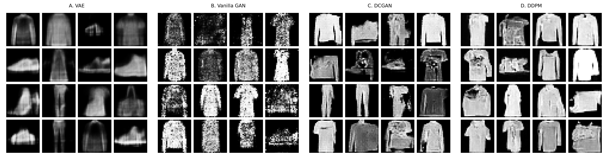
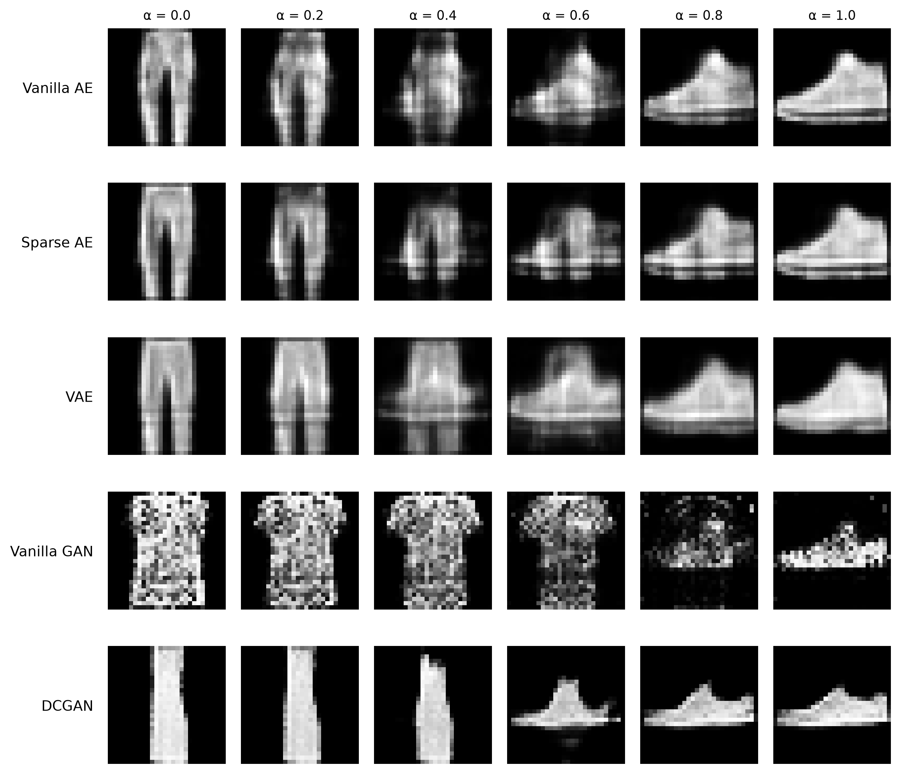

# Image Generation Models Comparison

An empirical comparison of six generative models on **Fashion-MNIST**: Vanilla AE, Sparse AE, VAE, Vanilla GAN, DCGAN, and DDPM. The project also proves, both theoretically and empirically, why the weights and latent features of an **MLP classifier** cannot be used to generate images.

📄 Full report (Indonesian): [`report/report.pdf`](report/report.pdf)



## Results

All metrics are measured on the test set (7,000 images). Latency is the time to produce one batch of 64 images on an RTX 3080.

| Model | Latent dim | Train time / epoch (s) | Latency (ms / 64) | MSE | PSNR (dB) | SSIM | FID |
|---|---|---|---|---|---|---|---|
| Vanilla AE | 64 | 0.75 | 0.15 | **0.0086** | **20.65** | **0.8291** | – |
| Sparse AE | 64 | 0.87 | 0.14 | 0.0098 | 20.10 | 0.8052 | – |
| VAE | 64 | 0.90 | **0.06** | 0.0135 | 18.69 | 0.7613 | 91.64 |
| Vanilla GAN | 100 | 1.22 | 0.13 | – | – | – | 147.81 |
| DCGAN | 100 | 3.36 | 0.36 | – | – | – | **33.65** |
| DDPM | 28×28 | 9.30 | 2778.91 | – | – | – | 44.17 |

Key findings:
- **Vanilla AE has the best reconstruction**, but it cannot generate new images. VAE gives up some reconstruction quality (MSE 0.0135) in exchange for a latent space it can sample from.
- **DCGAN has the best FID.** Its convolutional layers remove the speckle noise produced by the MLP-based Vanilla GAN.
- **DDPM is about 7,700× slower to sample than DCGAN**, because it needs 1,000 sequential denoising steps. This matches the generative trilemma.
- **The MLP classifier (88.13% test accuracy) cannot generate images:**
  - Wᵀ ≠ W⁻¹: ‖W₁ᵀW₁ − I‖_F = 219.72, and rank(W₁ᵀW₁) is 256 out of 784.
  - A decoder trained on its frozen latents reaches twice the MSE of an autoencoder.
  - Gaussian samples fall outside its sparse, non-negative latent distribution.



## Setup

Requires Python 3.12.

```bash
pip install -r requirements.txt
```

On Windows, `pip install torch` installs the CPU-only build. For GPU training, first install the CUDA build of `torch` / `torchvision` that matches your driver, using the command from [pytorch.org/get-started](https://pytorch.org/get-started/locally/).

Fashion-MNIST is downloaded automatically into `data/` on the first run.

## Usage

```bash
python main.py        # run the whole pipeline, step01 → step12
python main.py 6      # resume from step06 (earlier outputs must already exist)
```

`main.py` creates the output folders and runs each step in order. It stops at the first step that fails.

## Pipeline

| Script | Stage | Main outputs |
|---|---|---|
| `step01_train_classifier.py` | Train the MLP classifier (784→256→64→10) | `models/mlp_classifier.pt`, `weights/`, `latents/` |
| `step02_class_backproject.py` | Back-project one-hot class vectors through Wᵀ | `figures/class_backprojection.png` |
| `step03_latent_backproject.py` | Back-project test-image latents through Wᵀ | `figures/backprojection.png` |
| `step04_frozen_decoder.py` | Train a decoder on frozen classifier latents | `models/decoder_frozen_mlp.pt`, `figures/frozen_decoder.png` |
| `step05_prior_sampling.py` | Sample z ~ N(μ, diag σ²) from the classifier latents | `figures/prior_sampling.png` |
| `step06_autoencoders.py` | Vanilla AE and Sparse AE (L1 on h) | `models/ae.pt`, `models/sparse_ae.pt` |
| `step07_vae.py` | Variational Autoencoder | `models/vae.pt` |
| `step08_gan.py` | Vanilla (MLP) GAN | `models/gan_G.pt`, `models/gan_D.pt` |
| `step09_dcgan.py` | DCGAN | `models/dcgan_G.pt`, `models/dcgan_D.pt` |
| `step10_ddpm.py` | DDPM with a small U-Net (T = 1000) | `models/ddpm.pt` |
| `step11_evaluate.py` | MSE / PSNR / SSIM / FID / latency for every model | `logs/results.json` |
| `step12_figures.py` | The five comparison figures used in the report | `figures/fig1`–`fig5` |

Helper modules:
- `common.py`: shared `Decoder` / `AE` models, the `fit` / `evaluate` helpers, and the global seed.
- `datasplit.py`: the 80/10/10 train/validation/test split (seed 42).
- `recompute.py`: recomputes the step01/04/06 metrics from saved checkpoints when the training logs are missing.

## Project structure

```
├── step01 … step12_*.py   # one script per pipeline stage
├── main.py                # runs all stages in order
├── common.py, datasplit.py, recompute.py
├── figures/               # generated figures (tracked)
├── logs/results.json      # final metrics (tracked)
├── report/                # LaTeX source and compiled PDF
└── data/ models/ latents/ weights/   # generated, git-ignored
```
